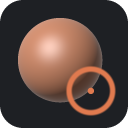

<p align="center">
  
</p>

<h1 align="center">OxyConvert</h1>

<p align="center"><strong>Universal bridge & converter: ZBrush, Blender, and Nomad Sculpt plugins into OxyBrush .oxyaddon packages.</strong></p>

<p align="center">
  <a href="https://github.com/crisprintsstuff/OxyConvert/releases"></a>
  <a href="https://github.com/crisprintsstuff/OxyConvert/actions/workflows/ci.yml"></a>
  
  <a href="rust-toolchain.toml"></a>
  
  <a href="#license"></a>
</p>

<p align="center">
  <a href="https://github.com/crisprintsstuff/OxyConvert/releases/latest"><b>Download</b></a> ·
  <a href="#quick-start-gui"><b>Studio GUI</b></a> ·
  <a href="#cli-usage"><b>CLI Reference</b></a> ·
  <a href="SPEC_OXYADDON.md"><b>.oxyaddon Spec</b></a> ·
  <a href="CONTRIBUTING.md"><b>Contributing</b></a> ·
  <a href="https://github.com/crisprintsstuff/OxyConvert/issues"><b>Report Issue</b></a>
</p>

---

## Overview

**OxyConvert** is an open-source desktop studio and high-throughput command-line tool built in pure safe Rust. It bridges existing digital sculpting pipelines by transpiling scripts, macros, and plugins from **Pixologic / Maxon ZBrush**, **Blender 3D**, and **Nomad Sculpt** into the standardized **`.oxyaddon`** package ecosystem designed for [**OxyBrush**](https://github.com/crisprintsstuff/OxyBrush).

OxyConvert features **dual runtime compilation**:
1. **In-Process WebAssembly (WASM - RFC 0011):** Transpiles mesh math, deformers, and button callbacks into native WebAssembly Text (`.wat`), compiled and executed in-process on OxyBrush worker threads with zero Python dependencies and native UI parameter sliders.
2. **Background Python Addon:** Transpiles high-level scene macros, companion texture handling, and pipeline bridges into sandboxed Python addons executed via OxyBrush's Model Context Protocol (MCP) and Python runtime.

---

## Downloads & Installation

Pre-built binaries are available for Windows, Linux, and macOS on the **[Releases](https://github.com/crisprintsstuff/OxyConvert/releases/latest)** page.

| Platform | Format | Description |
|---|---|---|
| **Windows 10 / 11** (x86_64) | [`.exe Installer`](https://github.com/crisprintsstuff/OxyConvert/releases/latest) | NSIS setup with desktop shortcuts, Start Menu integration, and `.oxyaddon` file association. |
| **Windows 10 / 11** (x86_64) | [`.zip Portable`](https://github.com/crisprintsstuff/OxyConvert/releases/latest) | Standalone portable executable bundle (no admin required). |
| **Linux** (x86_64 glibc 2.31+) | [`.tar.gz`](https://github.com/crisprintsstuff/OxyConvert/releases/latest) | Portable archive containing the `oxyconvert` binary and desktop metadata. |
| **macOS 11+** (Universal) | [`.dmg Disk Image`](https://github.com/crisprintsstuff/OxyConvert/releases/latest) | Drag-and-drop universal application bundle supporting both Apple Silicon (M1/M2/M3/M4) and Intel x86_64. |

---

## Supported Input Ecosystems

| Ecosystem | Inputs Detected | Transpilation Output |
|---|---|---|
| **ZBrush** | `.txt` (ZScript source), `.zsc` (compiled binary tokens), `.zip` multi-file installers | Parses `[IButton]`, `[ISlider]`, `[ISubPalette]`, math operators, and UI layout. Preserves companion `.ZMT`, `.psd`, and `.obj` assets into `assets/`. Generates WebAssembly deformation loops or Python bridge. |
| **Blender** | `.py` (single-file scripts / add-ons), `.zip` add-on archives | Parses `bl_info`, operator classes (`bpy.types.Operator`), panel layouts (`bpy.types.Panel`), and property definitions. Generates OxyBrush UI bindings and execution handlers. |
| **Nomad Sculpt** | `.js` (Nomad JavaScript plugins), `.json` (tool & brush presets) | Extracts parameter ranges, stroke falloff curves, and transformation matrix hooks into `.oxyaddon` definitions. |

---

## Features

- **Dual-Pane Studio GUI:**
  - Modern dark themes (Graphite, Charcoal, Slate, Warm Umber, ZBrush Classic).
  - Side-by-side editing: Live source editor on the left with syntax presets; live generated package inspector on the right with tabbed views for Manifest (`addon.json`), Python Bridge (`__init__.py`), WebAssembly Text (`plugin.wat`), Conversion Logs, and Package File Structure.
- **RFC 0011 WebAssembly Generator:**
  - Converts UI controls to `WasmParam` bindings (sliders, steppers, toggles).
  - Emits linear-memory vertex iteration loops (`read_positions`, `write_positions`, `read_mask`, `overlay`, `param`, `log`) for instantaneous real-time mesh operations.
- **Unique Package Namespacing:**
  - Dynamically sanitizes plugin names and IDs into isolated filesystem stems (`safe_stem()`). Never overwrites existing user plugins with generic folder names.
- **Lossless Companion Asset Packaging:**
  - Automatically identifies, validates, and routes textures (`.png`, `.jpg`, `.psd`), materials (`.ZMT`), and meshes (`.obj`) into the `.oxyaddon` `assets/` subfolder.
- **One-Click Direct Installation:**
  - Automatically detects OxyBrush plugin repositories across Windows (`AppData/Local/OxyBrush/plugins`), Linux (`~/.local/share/oxybrush/plugins`), and macOS (`~/Library/Application Support/OxyBrush/plugins`).
- **100% Safe Pure Rust:**
  - Enforces `#[forbid(unsafe_code)]` across the entire codebase.
  - Zero external C/C++ build toolchains required for core conversion routines.

---

## Quick Start (GUI)

Launch the interactive studio:

```bash
# Launch GUI directly
oxyconvert gui

# Or run without arguments to start the desktop interface
oxyconvert
```

1. Click **Open Source Script / Zip** or drag-and-drop a `.txt`, `.zsc`, `.py`, or `.zip` file into the editor.
2. Select target **Runtime Mode**:
   - `WebAssembly (WASM)` for in-process high-speed mesh transforms and native UI controls.
   - `Python` for high-level scripting, filesystem actions, and companion bridges.
3. Review the generated `.oxyaddon` manifest, `.wat` code, and logs in the right panel.
4. Click **Convert & Save Package** to build a `.oxyaddon` archive, or click **Install Directly into OxyBrush** for immediate testing in OxyBrush.

---

## CLI Reference

`oxyconvert` includes a complete CLI suite suitable for build scripts, CI pipelines, and batch conversions:

### 1. Convert Scripts or ZIP Packages
```bash
# Convert a ZBrush ZScript to an in-process WebAssembly .oxyaddon
oxyconvert convert path/to/plugin.txt -o plugins/my_plugin.oxyaddon --runtime wasm

# Convert a Blender addon ZIP to Python runtime .oxyaddon
oxyconvert convert path/to/blender_addon.zip -o plugins/blender_addon.oxyaddon --runtime python

# Specify custom metadata
oxyconvert convert script.txt --name "Sculpt Master" --category Deformers --author "Artist"
```

### 2. Inspect an Existing .oxyaddon Package
```bash
oxyconvert inspect path/to/plugin.oxyaddon
```

### 3. Direct Installation into OxyBrush
```bash
# Install a package directly into the user's OxyBrush plugins folder
oxyconvert install path/to/plugin.oxyaddon
```

### 4. Pack & Unpack Archives
```bash
# Unpack a .oxyaddon package to inspect or modify contents
oxyconvert unpack path/to/plugin.oxyaddon -o unpacked_dir/

# Pack a directory back into an .oxyaddon package
oxyconvert pack unpacked_dir/ -o repacked_plugin.oxyaddon
```

### 5. List Installed Plugins
```bash
oxyconvert list
```

### 6. Print the Official Specification
```bash
oxyconvert spec
```

---

## Building from Source

### Prerequisites
- [Rust 1.88+](https://www.rust-lang.org/) (pinned in `rust-toolchain.toml`).

```bash
# Clone the repository
git clone https://github.com/crisprintsstuff/OxyConvert.git
cd OxyConvert

# Build native release binary
cargo build --release

# Run test suite
cargo test

# Run code linters
cargo fmt --all --check
cargo clippy --all-targets --all-features -- -D warnings
```

### Cross-Compiling for Windows from Linux
```bash
# Install cargo-xwin and the MSVC target
cargo install cargo-xwin
rustup target add x86_64-pc-windows-msvc

# Build Windows release binary
cargo xwin build --release --target x86_64-pc-windows-msvc

# Build Windows installer using NSIS
makensis packaging/windows/installer.nsi
```

### Cross-Compiling Universal macOS App Bundle
```bash
rustup target add aarch64-apple-darwin x86_64-apple-darwin

# Build both targets
cargo build --release --target aarch64-apple-darwin
cargo build --release --target x86_64-apple-darwin

# Package universal .dmg
packaging/macos/make_app.sh 0.1.0
```

---

## Specification & Standards

OxyConvert follows the formal `.oxyaddon` specification outlined in [**SPEC_OXYADDON.md**](SPEC_OXYADDON.md) and OxyBrush's RFC 0011 (WebAssembly plugin standard).

Packages are standard ZIP archives containing:
```
addon.oxyaddon (ZIP archive)
├── addon.json         # Manifest (metadata, UI bindings, permissions, entrypoint)
├── plugin.wat         # WebAssembly Text module (kind: "wasm")
├── __init__.py        # Python entrypoint (kind: "python")
├── assets/            # Companion textures, icons, materials (.ZMT), meshes
└── docs/              # Readme, license, changelog
```

---

## Clean-room & Legal Notice

OxyConvert performs clean-room transpilation through public grammar parsing and documented syntax patterns. It does not circumvent digital rights management or proprietary protections. References to *ZBrush*, *Blender*, and *Nomad Sculpt* are made strictly to denote input format compatibility.

---

## License

Dual-licensed under either:
- **MIT License** ([LICENSE-MIT](LICENSE-MIT))
- **Apache License, Version 2.0** ([LICENSE-APACHE](LICENSE-APACHE))

at your option.
